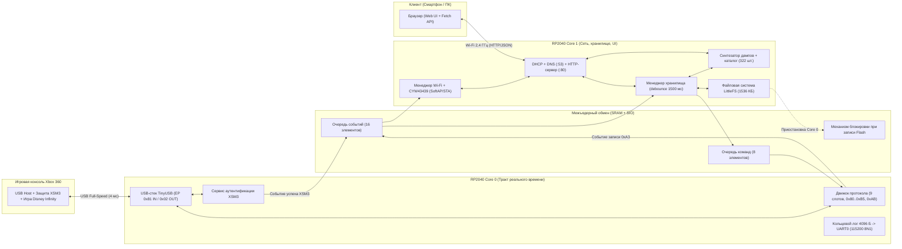
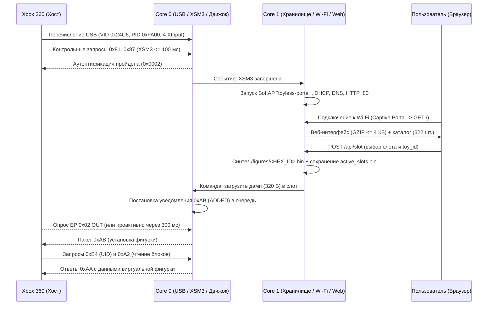

# Спецификация требований программного обеспечения (SRS)

**Наименование проекта:** Toyless — аппаратный эмулятор базы *Disney Infinity* для Xbox 360 с веб-интерфейсом управления на базе Raspberry Pi Pico W  
**Версия документа:** 1.2  
**Основание разработки:** Курсовой проект по дисциплине «Проектная деятельность 3»

---

## Паспорт документа

| Реквизит | Значение |
| :--- | :--- |
| **Образовательная организация** | ФГБОУ ВО «Сибирский государственный индустриальный университет» (СибГИУ) |
| **Кафедра** | Прикладных информационных технологий и программирования (ПИТиП), г. Новокузнецк |
| **Дисциплина** | Проектная деятельность 3 |
| **Тема курсового проекта** | «Разработка периферийного эмулятора Xbox 360 с веб-интерфейсом управления на базе Raspberry Pi Pico W» |
| **Заказчик проекта** | Кафедра прикладных информационных технологий и программирования СибГИУ |
| **Исполнитель (разработчик)** | Горбатых Никита Андреевич, обучающийся группы ИВТ-23 |
| **Научный руководитель** | Пермякова Елена Павловна, к.т.н., доцент кафедры ПИТиП |
| **Плановые сроки проекта** | 10.09.2026 — 01.04.2027 (осенний семестр 2026 г. — весенний семестр 2027 г.) |
| **Лицензия распространения** | GNU General Public License v3.0 ([LICENSE](../../LICENSE)) |

---

## Содержание

1. [Введение](#1-введение)
   - [1.1 Цели](#11-цели)
   - [1.2 Обзор](#12-обзор)
   - [1.3 Определения, сокращения, термины](#13-определения-сокращения-термины)
   - [1.4 Ссылки](#14-ссылки)
   - [1.5 Обзор документа](#15-обзор-документа)
2. [Общее описание](#2-общее-описание)
3. [Требования](#3-требования)
   - [3.1 Функциональность](#31-функциональность)
   - [3.2 Удобство использования](#32-удобство-использования)
   - [3.3 Надежность](#33-надежность)
   - [3.4 Производительность](#34-производительность)
   - [3.5 Поддерживаемость](#35-поддерживаемость)
   - [3.6 Проектные ограничения](#36-проектные-ограничения)
   - [3.7 Требования по документированности и поддержке пользователей](#37-требования-по-документированности-и-поддержке-пользователей)
   - [3.8 Заимствованные компоненты](#38-заимствованные-компоненты)
   - [3.9 Интерфейсы](#39-интерфейсы)
   - [3.10 Лицензионные соглашения](#310-лицензионные-соглашения)
   - [3.11 Необходимые замечания по законодательству, авторским правам и прочие](#311-необходимые-замечания-по-законодательству-авторским-правам-и-прочие)
   - [3.12 Применяемые стандарты](#312-применяемые-стандарты)
4. [Сопроводительная информация](#4-сопроводительная-информация)

---

## 1. Введение

### 1.1 Цели

Настоящая Спецификация требований программного обеспечения (Software Requirements Specification, SRS) предназначена для установления базы соглашения между заказчиком (кафедрой ПИТиП СибГИУ) и разработчиком о том, как должен функционировать разрабатываемый программно-аппаратный продукт **Toyless**.

Цели создания документа:
1. Формализовать функциональные и нефункциональные требования к эмулятору периферийной базы *Disney Infinity* для игровой консоли Microsoft Xbox 360 на микроконтроллере Raspberry Pi Pico W.
2. Задать измеримые технические параметры, ограничения проектирования, форматы входных и выходных данных, а также требования к внешним интерфейсам до начала этапов разработки прототипа (MVP) и релизной версии.
3. Определить критерии приёмки первой работающей сборки и последующих итераций разработки, а также основу для составления сценариев тестирования и сопровождения.

### 1.2 Обзор

Проектируемый продукт **Toyless** представляет собой автономный аппаратно-программный эмулятор оригинального USB-портала *Disney Infinity* (производства PDP) для консоли **Microsoft Xbox 360** на базе отладочной платы **Raspberry Pi Pico W**.

Игровая серия *Disney Infinity* (2013–2016 гг.) относится к жанру *toys-to-life* и требует установки на физический считыватель (портал) коллекционных фигурок, плейсетов и жетонов со встроенными RFID/NFC-метками. После прекращения выпуска серии в 2016 году оригинальные базы и редкие фигурки стали труднодоступными и дорогостоящими, а их физические чипы подвержены износу. Существующие открытые эмуляторы (рассчитанные на ПК, PlayStation и Nintendo) используют стандартный класс USB HID и несовместимы с Xbox 360, так как консоль требует обязательной двусторонней криптографической аутентификации по протоколу **XSM3 (Xbox Security Method 3)** и специфических дескрипторов класса **Microsoft XID**.

Разрабатываемая система должна:
- эмулировать на шине USB оригинальную базу *Disney Infinity* для Xbox 360 и проходить аппаратно-криптографическую проверку XSM3;
- программно моделировать 3 физические зоны портала (9 логических слотов) и обработку команд протокола *Disney Infinity*;
- обеспечивать встроенный каталог виртуальных фигурок и жетонов с генерацией валидных бинарных дампов и сохранением игрового прогресса в энергонезависимой памяти;
- предоставлять автономный веб-интерфейс управления по беспроводной сети Wi-Fi (через собственную точку доступа с Captive Portal или подключение к домашней сети) без необходимости использования стороннего ПК или установки клиентских приложений.

### 1.3 Определения, сокращения, термины

#### Глоссарий

| Термин / сокращение | Определение |
| :--- | :--- |
| **AMP (Asymmetric Multiprocessing)** | Асимметричное многопроцессорное разделение задач, при котором одно ядро микроконтроллера обслуживает критичные ко времени прерывания USB и криптографию, а второе — сетевой стек, файловую систему и веб-интерфейс |
| **Captive Portal** | Механизм перехвата DNS- и HTTP-запросов при подключении клиента к беспроводной сети для автоматического открытия веб-интерфейса управления |
| **CRC32** | 32-битная циклическая контрольная сумма, применяемая для проверки целостности заголовка дампа фигурки |
| **CYW43439** | Встроенный радиомодуль беспроводной связи платы Raspberry Pi Pico W (Wi-Fi IEEE 802.11b/g/n, диапазон 2,4 ГГц) |
| **Debounce (отложенная запись)** | Механизм объединения серии операций записи в энергонезависимую память с фиксированной задержкой для снижения износа Flash-памяти |
| **ICC (Inter-Core Communication)** | Программный механизм межъядерного обмена командами и событиями без взаимного блокирования ядер |
| **LittleFS** | Отказоустойчивая журналируемая файловая система для встроенной Flash-памяти микроконтроллеров с выравниванием износа |
| **lwIP** | Легковесный стек протоколов TCP/IP, предназначенный для встраиваемых систем без операционной системы |
| **MIFARE Classic** | Семейство бесконтактных RFID/NFC-меток стандарта ISO/IEC 14443 Type A, применяемых в оригинальных фигурках *Disney Infinity* |
| **RP2040** | Двухъядерный микроконтроллер ARM Cortex-M0+ (133 МГц, 264 КБ SRAM, 2 МБ Flash) |
| **SoftAP / STA** | Режимы работы Wi-Fi: точка доступа (`SoftAP`, создаёт собственную сеть) и клиентская станция (`STA`, подключается к внешнему маршрутизатору) |
| **Toy ID** | Уникальный 24-битный идентификатор персонажа, плейсета или жетона в системе *Disney Infinity* |
| **UF2** | Формат образа прошивки для загрузки в микроконтроллер RP2040 через эмулируемый USB-накопитель режима `BOOTSEL` |
| **XID / XInput** | Проприетарный класс и интерфейс USB-периферии игровой консоли Microsoft Xbox 360 |
| **XIP (Execute-in-Place)** | Режим прямого исполнения кода и чтения констант из внешней Flash-памяти без копирования в SRAM |
| **XSM3 (Xbox Security Method 3)** | Закрытый криптографический протокол проверки подлинности USB-устройств на консоли Microsoft Xbox 360 |

#### Соглашения об оформлении требований

В соответствии с методическими рекомендациями к проекту:
- функциональные требования делятся на **Функцию** (*то, что делает система*) и **Поведение** (*как система должна это делать*);
- идентификаторы требований имеют вид: `FR-*` (функциональные), `UC-*` (варианты использования), `ERR-*` (обработка ошибок), `IO-*` (входные и выходные данные), `UX-*` (удобство использования), `REL-*` (надёжность), `PERF-*` (производительность), `MAINT-*` (поддерживаемость), `CON-*` (проектные ограничения), `DOC-*` (документированность), `EXT-*` (внешние интерфейсы);
- приоритеты требований задаются по шкале MoSCoW: **Must** (обязательно для первого рабочего прототипа MVP), **Should** (должно быть реализовано в релизной версии), **Could** (опциональное расширение функциональности).

### 1.4 Ссылки

1. Методические материалы по проектной деятельности: *«Определение требований к проекту»* ([Требования к проекту.pdf](../../Требования%20к%20проекту.pdf)).
2. Материалы инициации и планирования курсового проекта ([main.pdf](../../main.pdf)).
3. Документация проекта и лицензионное соглашение: [README.md](../../README.md), [LICENSE](../../LICENSE).
4. Техническая документация платформы: [Raspberry Pi Pico SDK](https://github.com/raspberrypi/pico-sdk), [TinyUSB](https://github.com/hathach/tinyusb), [littlefs](https://github.com/littlefs-project/littlefs).
5. Референсные открытые исследования протоколов: [libxsm3](https://github.com/InvoxiPlayGames/libxsm3), [ExCrypt](https://github.com/emoose/ExCrypt), [Dolphin Emulator](https://github.com/dolphin-emu/dolphin), [RPCS3](https://github.com/RPCS3/rpcs3), [Santroller](https://github.com/santroller/santroller), [portal_of_flipper](https://github.com/sanjay900/portal_of_flipper), документация D.I.R.E.

### 1.5 Обзор документа

Настоящая спецификация ориентирована на всех участников процесса разработки и приёмки проекта:
- **Системному и бизнес-аналитику (руководителю проекта)** документ позволяет проверить соответствие бизнес-целям, сценариям пользователей и границам проекта (Разделы 1, 2, 3.1, 4.2).
- **Программисту** спецификация задаёт точную логику работы, форматы пакетов, структуры данных, обработку ошибок и интерфейсы подсистем (Раздел 3.1, Разделы 3.3–3.9, Приложения).
- **Тестировщику** документ предоставляет измеримые критерии проверки, граничные значения, сценарии ошибок и эталоны входных/выходных данных (Разделы 3.1, 3.3, 3.4, 4.3).
- **Специалисту сопровождения и пользователю** спецификация описывает среду функционирования, диагностические интерфейсы, типовые сбои и ограничения эксплуатации (Разделы 2, 3.6, 3.7, 3.9).

---

## 2. Общее описание

### 2.1 Видение продукта и сравнение с аналогами

Продукт **Toyless** должен обеспечить владельцам консоли Xbox 360 доступный, компактный и полностью автономный способ игры в *Disney Infinity* (версий 1.0, 2.0 и 3.0) без покупки физических фигурок и оригинального портала.

| Критерий сравнения | Оригинальный портал | D.I.R.E. / ПК-решения | Эмуляторы RPCS3 / Dolphin | Разрабатываемый продукт (Toyless) |
| :--- | :---: | :---: | :---: | :---: |
| **Работа с реальной Xbox 360** | Да | Нет | Нет | **Да** |
| **Отказ от физических фигурок** | Нет | Да | Да | **Да** |
| **Прохождение проверки XSM3** | Аппаратное | Отсутствует | Программный обход в ОС | **Программное на МК** |
| **Управление** | Физическая перестановка | Консоль ПК | GUI эмулятора | **Встроенный Web UI по Wi-Fi** |
| **Автономность (без стороннего ПК)** | Да | Нет | Нет | **Да** |

### 2.2 Классы и характеристики пользователей

1. **Игроки и владельцы консолей Xbox 360:** пользователи без специальных навыков программирования. Им требуются простая прошивка готового устройства («подключил и играй») и интуитивно понятный веб-интерфейс на экране смартфона.
2. **Энтузиасты сохранения видеоигр (Game Preservation):** опытные пользователи ПК, которым важны достоверность эмуляции протокола, полный каталог персонажей и возможность резервного копирования дампов прогресса.
3. **Разработчики встроенных систем и тестировщики:** специалисты, осуществляющие сборку прошивки, модульное и стендовое тестирование, анализ отладочных логов по UART и развитие функциональности.
4. **Заказчик и научный руководитель (кафедра ПИТиП СибГИУ):** оценивают полноту реализации требований, соблюдение стандартов оформления и выполнение календарного плана.

### 2.3 Операционная среда

Система должна функционировать в следующей программно-аппаратной среде:
- **Целевая аппаратная платформа:** отладочная плата **Raspberry Pi Pico W** на базе микроконтроллера `RP2040` (2 ядра ARM Cortex-M0+, тактовая частота `133 МГц`, `264 КБ` SRAM, `2 МБ` встроенной QSPI Flash, радиомодуль Infineon `CYW43439` с поддержкой IEEE `802.11b/g/n` на частоте `2,4 ГГц`).
- **Подключаемый хост:** игровая консоль **Microsoft Xbox 360** (аппаратные ревизии Fat/Jasper, Slim/Trinity, Corona, E) с запущенной игрой серии *Disney Infinity* (`1.0`, `2.0`, `3.0`).
- **Клиентское устройство управления:** смартфон, планшет или ПК с модулем Wi-Fi (`2,4 ГГц`) и современным веб-браузером (поддержка HTML5, CSS3, ES6 Fetch API).
- **Среда разработки и диагностики:** кросс-компилятор `arm-none-eabi-gcc` (версия `12+`) с `newlib`, `CMake` (`3.20+`), `Ninja` или `make`, `Git`, а также USB-UART переходник и терминал (`115200 baud, 8N1`).

### 2.4 Допущения, зависимости и риски

**Допущения и зависимости:**
- подключение к Xbox 360 выполняется исправным кабелем Micro-USB с передачей данных (`D+`/`D-`) и питанием `5 В`;
- разработка опирается на открытый SDK платформы (`Raspberry Pi Pico SDK`), стек `TinyUSB`, файловую систему `LittleFS`, сетевой стек `lwIP`, криптографические библиотеки `libxsm3` и `tiny-aes`.

**Оценка проектных рисков и планируемые меры их нейтрализации** (по методике `5 × 5`, `R = P × I`, ГОСТ Р ИСО/МЭК 31010-2011; высокий: `R >= 15`, средний: `8 <= R <= 14`, низкий: `R <= 6`):

| Код | Описание рискового события | P | I | R | Планируемые меры нейтрализации | R_ост |
| :---: | :--- | :---: | :---: | :---: | :--- | :---: |
| **Р1** | Конфликт прерываний контроллера USB и радиомодуля `CYW43439`, приводящий к срыву таймингов и сбросу соединения Xbox 360 | 4 | 5 | **20** | Изоляция ядер по модели AMP (`Core 0` — USB и протокол, `Core 1` — Wi-Fi и Flash), обмен через неблокирующие очереди, отложенный запуск Wi-Fi после завершения `XSM3` или таймаута `10 000 мс` | **4** |
| **Р2** | Превышение допустимого времени криптографического ответа `XSM3` (`100 мс`) | 3 | 5 | **15** | Использование оптимизированной библиотеки `libxsm3` на выделенном `Core 0`, статическое выделение буферов, отсутствие сетевой активности до завершения аутентификации | **3** |
| **Р3** | Дефицит оперативной памяти SRAM (`264 КБ`) при сетевых пиках TCP/IP | 3 | 3 | **9** | Конфигурация `lwIP` без ОС (`NO_SYS = 1`) и без динамического `malloc`, статический пул кучи (`8000 Б`) и пакетов (`24` буфера), ограничение числа TCP-соединений (`4`), хранение сжатого UI и каталога во Flash (`XIP`) | **3** |
| **Р4** | Аппаратная несовместимость дескрипторов с отдельными ревизиями Xbox 360 (Fat/Jasper, Slim/Trinity, Corona, E) | 2 | 4 | **8** | Точное воспроизведение дескрипторов оригинальной базы PDP (`VID 0x24C6 / PID 0xFA00`), динамическое формирование пакета `XSM3` с контрольной суммой, стендовые испытания на реальной консоли | **2** |
| **Р5** | Повреждение дампов фигурок во Flash при внезапном обесточивании USB | 3 | 3 | **9** | Применение отказоустойчивой журналируемой ФС `LittleFS`, отложенная запись (`1500 мс`), проверка целостности заголовка по `CRC32`, безопасная блокировка второго ядра при записи во Flash | **2** |

---

## 3. Требования

### 3.1 Функциональность

Ниже изложены функциональные требования к проектируемой системе, структурированные в формате **Функция** + **Поведение**, а также варианты использования, правила обработки ошибок и спецификация входных/выходных данных.

#### Подсистема 1. USB-эмуляция и аутентификация Xbox 360

- **`FR-1.1` Идентификация устройства на шине USB** *(Приоритет: Must)*
  - **Функция:** предъявление устройства консоли Xbox 360 в качестве оригинальной базы *Disney Infinity*.
  - **Поведение:** при подключении по шине USB система должна отдавать дескриптор устройства со следующими параметрами: `bcdUSB = 0x0200`, класс/подкласс/протокол `0xFF/0xFF/0xFF`, максимальный размер пакета `EP0` — `8 байт`, `idVendor = 0x24C6` (PDP), `idProduct = 0xFA00`, `bcdDevice = 0x0100`, строковые дескрипторы `"Disney"` (производитель), `"Disney Infinity Base"` (продукт), 8-символьный шестнадцатеричный серийный номер на основе уникального идентификатора чипа `RP2040` и обязательную строку безопасности Microsoft с символом авторского права `©` (`U+00A9`).
- **`FR-1.2` Эмуляция 4-интерфейсной конфигурации XInput** *(Приоритет: Must)*
  - **Функция:** предоставление хосту полной структуры интерфейсов и конечных точек XInput.
  - **Поведение:** система должна отдавать конфигурационный дескриптор длиной ровно `153 байта`, содержащий 4 интерфейса: Интерфейс 0 (основной обмен данными базы: подкласс `0x5D`, подтип XInput `0x24` в 17-байтном поддескрипторе, конечные точки прерываний `EP 0x81 IN` и `EP 0x02 OUT` по `32 байта` с интервалом опроса `4 мс`), Интерфейс 1 (аудиоподсистема Xbox, 4 конечные точки), Интерфейс 2 (модуль расширения, 1 конечная точка `0x86 IN`) и Интерфейс 3 (подсистема безопасности XSM3 `0xFF/0xFD/0x13`).
- **`FR-1.3` Двусторонняя криптографическая аутентификация XSM3** *(Приоритет: Must)*
  - **Функция:** прохождение проверки подлинности южным мостом консоли Xbox 360.
  - **Поведение:** система должна обрабатывать стандартные запросы `GET_REPORT` (`0x01`: 4-байтный серийный номер, 20-байтные возможности ввода, 8-байтные возможности вибрации) и вендорные контрольные запросы: `0x81` (формирование и передача 29-байтного идентификационного пакета с `VID/PID` и XOR-контрольной суммой), `0x82` (приём 34-байтного запроса инициализации), `0x83` (передача 48-байтного ответа), `0x84` (подтверждение статуса), `0x86` (передача 2-байтного состояния авторизации `0x0002`), `0x87` (приём и верификация 22-байтного подтверждения) и `0x00` (подтверждение команд LED/вибрации). После успешной проверки `0x87` система должна устанавливать флаг авторизации и уведомлять сетевую подсистему о завершении рукопожатия.
- **`FR-1.4` Обработка сброса шины USB** *(Приоритет: Must)*
  - **Функция:** восстановление готовности к повторной аутентификации при USB Reset.
  - **Поведение:** при получении сигнала сброса шины USB система должна сбрасывать состояние конечного автомата XSM3 и таймеры отложенных уведомлений.

#### Подсистема 2. Эмуляция протокола команд *Disney Infinity*

- **`FR-2.1` Транспортная обёртка пакетов Xbox 360** *(Приоритет: Must)*
  - **Функция:** согласование формата кадров между шиной XInput и логикой протокола *Disney Infinity*.
  - **Поведение:** система должна принимать по `EP 0x02 OUT` 32-байтные пакеты, начинающиеся с 2-байтной обёртки `0x0B 0x15`, и дополнять все исходящие 32-байтные пакеты на `EP 0x81 IN` префиксом `0x0B 0x15` с заполнением неиспользуемого остатка нулями.
- **`FR-2.2` Активация базы и синхронизация ГПСЧ (`0x80`, `0x81`, `0x83`)** *(Приоритет: Must)*
  - **Функция:** инициализация сеанса игры и генерация псевдослучайных чисел для шифрованного обмена.
  - **Поведение:** на команду активации `0x80` система должна возвращать 24-байтный ответ `0xAA` с сохранением номера последовательности `seq` и пересчитанной 8-битной аддитивной контрольной суммой. На команду `0x81` система должна дескремблировать 64-битный аргумент с помощью эталонной маски, инициализировать 4-регистровый ГПСЧ и выполнить 23 итерации прогрева. На команду `0x83` система должна генерировать очередное 32-битное число, скремблировать его в 64 бита и возвращать в 12-байтном ответе `0xAA`.
- **`FR-2.3` Моделирование 9 логических слотов на 3 зонах** *(Приоритет: Must)*
  - **Функция:** виртуальное размещение фигурок, плейсетов и жетонов на портале.
  - **Поведение:** система должна поддерживать `9` слотов по `320 байт` каждый: слоты `0–2` для центральной шестиугольной зоны (Hex Pad, код `0x10`, идентификатор площадки `1`), слоты `3–5` для зоны Игрока 1 (код `0x20`, площадка `2`) и слоты `6–8` для зоны Игрока 2 (код `0x30`, площадка `3`). Каждой активной фигурке должен назначаться уникальный порядок добавления `order` в диапазоне `0..15`.
- **`FR-2.4` Опрос присутствия и чтение идентификаторов (`0xA1`, `0xB4`)** *(Приоритет: Must)*
  - **Функция:** информирование игры об установленных объектах и их NFC UID.
  - **Поведение:** на команду `0xA1` система должна формировать ответ `0xAA` со списком 2-байтных дескрипторов `(base_code | order, 0x09)` для всех занятых слотов. На команду `0xB4` по заданному `order` система должна возвращать 7-байтный UID из начала дампа соответствующего слота в 12-байтном ответе `0xAA`.
- **`FR-2.5` Чтение и запись блоков памяти фигурок (`0xA2`, `0xA3`)** *(Приоритет: Must)*
  - **Функция:** передача игре характеристик персонажа и сохранение игрового прогресса.
  - **Поведение:** при получении команды чтения `0xA2` система должна отображать виртуальный индекс блока `b` в физический блок дампа (`0 -> 1`, `b >= 1 -> b * 4`) и возвращать `16 байт` данных в 21-байтном ответе `0xAA`. При получении команды записи `0xA3` система должна обновлять соответствующие `16 байт` в ОЗУ слота, немедленно отвечать игре 5-байтным подтверждением `0xAA` и инициировать событие сохранения в энергонезависимую память.
- **`FR-2.6` Уведомления об установке и снятии фигурок (`0xAB`)** *(Приоритет: Must)*
  - **Функция:** оперативное оповещение игры об изменении состава фигурок на портале.
  - **Поведение:** при установке или снятии фигурки система должна помещать 7-байтный пакет `0xAB 0x04 <pad_id> 0x09 <order> <0x00|0x01> <crc>` в кольцевую очередь FIFO ёмкостью не менее `16` событий. Пакеты должны отдаваться при очередном опросе от хоста, либо проактивно отправляться системой, если хост не запрашивал данные более `300 мс`.
- **`FR-2.7` Обработка команд подсветки и статуса (`0x90–0x96`, `0xB5`)** *(Приоритет: Must / Should)*
  - **Функция:** корректный приём команд управления светодиодной подсветкой зон портала и запроса статуса.
  - **Поведение:** в базовом прототипе система должна отвечать на команды `0x90`, `0x92`, `0x93`, `0x95`, `0x96` и `0xB5` стандартным 4-байтным подтверждением `0xAA 0x01 <seq> <crc>`. В целевой версии (Итерация 2) система должна дополнительно декодировать RGB-цвет и режим свечения для каждой из 3 зон и передавать их для отображения в веб-интерфейсе.

#### Подсистема 3. Каталог фигур, синтез дампов и энергонезависимое хранилище

- **`FR-3.1` Встроенный каталог фигурок и жетонов** *(Приоритет: Must)*
  - **Функция:** предоставление пользователю полной базы совместимых объектов *Disney Infinity*.
  - **Поведение:** прошивка должна содержать статический каталог из `322` объектов (персонажи, плейсеты, круглые диски способностей, шестиугольные диски миров/транспорта) серий `1.0`, `2.0` и `3.0` с указанием `toy_id`, серии, типа и названия, а также его сжатое GZIP-представление для отдачи по HTTP.
- **`FR-3.2` Синтез и проверка 320-байтных дампов MIFARE** *(Приоритет: Must)*
  - **Функция:** генерация криптографически корректных виртуальных меток без наличия физических оригиналов.
  - **Поведение:** система должна синтезировать 320-байтный дамп: формировать 7-байтный UID (префикс `0x04` и 6 случайных байт, либо заданный UID), заполнять служебные трейлеры секторов `0..4`, вычислять 16-байтный ключ `AES-128` с помощью `SHA-1` от 31-байтного префикса и UID, записывать `toy_id`, метаданные и `CRC32` в блок 1, а затем шифровать блок 1 и блоки сохранения (`4, 8, 12, 13`) алгоритмом `AES-128-CBC` с нулевым IV. Система также должна уметь расшифровывать блок 1 и проверять валидность дампа по `CRC32`.
- **`FR-3.3` Энергонезависимое хранение и отложенная запись (Debounce)** *(Приоритет: Must)*
  - **Функция:** сохранение прогресса персонажей и конфигурации слотов во Flash-памяти.
  - **Поведение:** система должна монтировать файловую систему `LittleFS` в разделе размером `1536 КБ` (автоматически форматируя её при первом запуске или повреждении и создавая каталоги `/figures` и `/saves`). Запись обновлённого игрой дампа в файл `/figures/<HEX_ID>.bin` должна выполняться не ранее чем через `1500 мс` после последней модификации слота, а при принудительной смене или очистке слота несохранённые данные должны сбрасываться немедленно до удаления.
- **`FR-3.4` Восстановление расстановки при включении** *(Приоритет: Must)*
  - **Функция:** сохранение состояния портала между сеансами питания.
  - **Поведение:** система должна сохранять пути активных слотов в файл `/saves/active_slots.bin` (`9 × 64 байта`) и автоматически загружать указанные фигурки в слоты при следующем включении устройства.

#### Подсистема 4. Беспроводная сеть Wi-Fi, Captive Portal и веб-управление

- **`FR-4.1` Отложенная активация Wi-Fi и режим точки доступа (`SoftAP`)** *(Приоритет: Must)*
  - **Функция:** создание автономной беспроводной сети для управления эмулятором без помех для USB-аутентификации.
  - **Поведение:** инициализация радиомодуля должна откладываться до получения события об успешной XSM3-аутентификации, либо выполняться принудительно по истечении `10 000 мс` после старта (при питании не от Xbox 360). По умолчанию система должна поднимать открытую точку доступа `toyless-portal` с IP-адресом `192.168.4.1`, встроенным DHCP-сервером и DNS-сервером (`UDP :53`), перенаправляющим запросы на портал.
- **`FR-4.2` Подключение к домашней сети Wi-Fi (`STA`) и откат** *(Приоритет: Should)*
  - **Функция:** опциональная работа устройства в домашней локальной сети пользователя.
  - **Поведение:** при наличии сохранённой конфигурации в `/saves/wifi.cfg` (до 32 символов SSID и до 64 символов пароля) система должна пытаться подключиться по `WPA2-AES-PSK` в течение `8000 мс`. При неудаче подключения клиентский режим должен отключаться с автоматическим переходом в режим `SoftAP`.
- **`FR-4.3` Механизм Captive Portal и встроенный HTTP-сервер** *(Приоритет: Must)*
  - **Функция:** автоматическое открытие панели управления и обработка API-запросов.
  - **Поведение:** HTTP-сервер на порту `80` должен поддерживать до `4` одновременных TCP-соединений, обрабатывать системные URL проверки подключения (`/generate_204`, `/gen_204`, `/hotspot-detect.html`, `/ncsi.txt`, `/connecttest.txt`, `/canonical.html`) перенаправлением `302 Found` на `http://192.168.4.1/`, отдавать сжатый GZIP веб-интерфейс (`GET /`), каталог (`GET /api/catalog`), статус (`GET /api/status`), проверку доступности (`GET /api/ping`) и команды управления слотами (`POST /api/slot`) и Wi-Fi (`POST /api/wifi`).
- **`FR-4.4` Конфигурация и управление слотами через веб-интерфейс** *(Приоритет: Must)*
  - **Функция:** визуальный выбор, поиск, установка и снятие фигурок с экрана браузера.
  - **Поведение:** веб-приложение должно отображать 3 зоны портала (9 карточек слотов), опрашивать статус каждые `3000 мс`, предоставлять модальный каталог с поиском по названию и фильтрацией по сериям (`1.0 / 2.0 / 3.0`) и типам объектов. При выборе фигурки сервер должен при необходимости синтезировать файл `/figures/<HEX_ID>.bin` и загрузить его в выбранный слот; при нажатии кнопки снятия — очистить слот.

#### Подсистема 5. Планируемое расширение (последующие итерации)

- **`FR-5.1` Импорт и экспорт пользовательских дампов `.bin`** *(Приоритет: Should)*
  - **Функция:** резервное копирование и загрузка сторонних дампов через браузер.
  - **Поведение:** система должна предоставлять интерфейс для скачивания сохранённых 320-байтных файлов `.bin` и загрузки внешних файлов на устройство с проверкой точного размера (`320 байт`) и валидацией `CRC32` заголовка, а также привязкой имени файла к `toy_id`.
- **`FR-5.2` Визуализация RGB-подсветки базы в веб-интерфейсе** *(Приоритет: Should)*
  - **Функция:** отображение игровых световых эффектов портала на экране смартфона.
  - **Поведение:** веб-интерфейс должен отображать актуальный цвет свечения каждой из 3 зон на основании декодированных команд `0x90–0x96`.
- **`FR-5.3` Экран настройки Wi-Fi (`STA`) в веб-интерфейсе** *(Приоритет: Should)*
  - **Функция:** пользовательская настройка подключения к домашнему роутеру без ручных API-запросов.
  - **Поведение:** веб-интерфейс должен предоставлять форму ввода `SSID` и пароля и кнопку сброса сохранённых сетевых настроек.
- **`FR-5.4` Режим стандартной USB HID-базы** *(Приоритет: Could)*
  - **Функция:** расширение совместимости на ПК, PlayStation 3/4 и Nintendo Wii/Wii U.
  - **Поведение:** прошивка должна поддерживать конфигурацию или переключение в стандартный класс USB HID без аутентификации XSM3.

---

#### Варианты использования (Use Cases)

1. **`UC-01` Первичное подключение к Xbox 360 и открытие панели управления:** пользователь подключает Raspberry Pi Pico W кабелем Micro-USB к консоли Xbox 360 -> устройство проходит аутентификацию XSM3 менее чем за `100 мс` -> запускается точка доступа `toyless-portal` -> пользователь подключается к ней со смартфона -> автоматически открывается Captive Portal с веб-интерфейсом (при подключении к обычному питанию без Xbox 360 сеть запускается через `10 000 мс`).
2. **`UC-02` Размещение фигурки, плейсета или диска на виртуальном портале:** пользователь нажимает `+ Выбрать` на нужной карточке слота -> открывается окно выбора с предвыбранным фильтром типа -> при необходимости уточняет поиск по имени или серии -> выбирает объект -> устройство синтезирует дамп (если его ещё нет в памяти), сохраняет расстановку и уведомляет игру по USB (`0xAB`), после чего персонаж или мир появляется в игре.
3. **`UC-03` Сохранение игрового прогресса персонажа:** во время игры консоль отправляет команду записи блока (`0xA3`) -> устройство обновляет данные в оперативной памяти и немедленно подтверждает запись игре -> спустя `1500 мс` после окончания серии записей прогресс сохраняется во Flash-память.
4. **`UC-04` Снятие фигурки со слота:** пользователь нажимает `✕ Снять` на активном слоте -> устройство принудительно сбрасывает несохранённые изменения (если они были), удаляет объект из слота, обновляет список активных слотов и отправляет игре уведомление об удалении (`0xAB`).
5. **`UC-05` Восстановление расстановки после выключения:** при следующем включении консоли устройство считывает сохранённую расстановку слотов из Flash и автоматически подгружает ранее выбранные фигурки.
6. **`UC-06` Подключение к домашней сети Wi-Fi (`STA`):** пользователь настраивает `SSID` и пароль -> при следующем запуске устройство подключается к роутеру в течение `8000 мс` (при ошибке или отсутствии сети автоматически возвращается в режим `SoftAP`).
7. **`UC-07` Отладка и мониторинг по UART:** разработчик или тестировщик подключает USB-UART адаптер (`115200 baud, 8N1`) к выводам платы и наблюдает диагностические сообщения обоих ядер.
8. **`UC-08` (Итерация 2) Резервное копирование и загрузка дампов `.bin`:** пользователь через веб-интерфейс выгружает файл прогресса персонажа на смартфон/ПК или загружает собственный 320-байтный дамп.

#### Обработка ошибок и исключительных ситуаций (Отчет об ошибках)

| Код | Ошибка / исключение | Требуемое поведение системы |
| :--- | :--- | :--- |
| **`ERR-01`** | Некорректный формат JSON, выход номера слота за пределы `0..8`, несуществующий `toy_id` или длина пути `>= 64` символов в HTTP POST | Сервер должен отклонить запрос с кодом `400 Bad Request` (`text/plain`) без изменения состояния слотов и Flash |
| **`ERR-02`** | Превышение буфера HTTP-запроса (`> 1535 байт`) или зависание неактивного TCP-клиента | Сервер должен принудительно закрывать соединение по превышению лимита или после `10` холостых циклов опроса |
| **`ERR-03`** | Превышение числа одновременных HTTP-соединений (`> 4`) | Новые входящие подключения сверх лимита должны отклоняться без разрыва уже обслуживаемых сессий |
| **`ERR-04`** | Обращение по неизвестному URI | Сервер должен возвращать ответ `404 Not Found` |
| **`ERR-05`** | Потеря связи браузера с устройством | В строке состояния веб-интерфейса должно отображаться `"Ошибка связи с базой"`, опрос должен продолжаться каждые `3000 мс`, а ошибка при установке/снятии слота — выводиться во всплывающем уведомлении |
| **`ERR-06`** | Недоступность настроенной домашней Wi-Fi сети (`STA`) в течение `8000 мс` | Система должна отключить режим `STA`, записать сообщение в диагностический лог и автоматически переключиться в режим `SoftAP` (`toyless-portal`) |
| **`ERR-07`** | Неформатированный или повреждённый раздел `LittleFS` | Система должна автоматически выполнить форматирование раздела, пересоздать каталоги `/figures` и `/saves` и запуститься с пустыми слотами |
| **`ERR-08`** | Повреждение 320-байтного дампа (ошибка `CRC32` в блоке 1) | Система должна отвергать повреждённый файл (возвращать нулевой идентификатор) и фиксировать несовпадение контрольной суммы в логе |
| **`ERR-09`** | Переполнение очередей уведомлений (`0xAB`), буфера передачи USB или кольцевого лога UART | Система не должна зависать: очередь уведомлений вытесняет старейшее событие, буфер USB отбрасывает новый пакет с записью в лог, а буфер лога приостанавливает запись до выгрузки |
| **`ERR-10`** | Нарушение обёртки USB-пакета (`!= 0x0B 0x15`) или провал проверки XSM3 | Ошибка фиксируется в UART-логе; некорректный контрольный запрос отклоняется состоянием STALL, приём следующего пакета на `EP 0x02 OUT` остаётся активным |

#### Входные и выходные данные (для разработки и тестирования)

| ID | Поток данных | Формат, размер и технические условия | Пример / критерий проверки |
| :--- | :--- | :--- | :--- |
| **`IO-1.1`** (Вход) | Команды игры на `EP 0x02 OUT` | Кадр `32 байта`: `[0x0B, 0x15, 0xFF, len, cmd, seq, payload..., crc]` | Команда активации: `0B 15 FF 01 80 00 ...`; чтение блока: `0B 15 FF 03 A2 <seq> 00 01 <crc>` |
| **`IO-1.2`** (Вход) | Криптозапросы XSM3 на `EP0` | USB `SETUP` + полезная нагрузка `34 байта` (`0x82`) или `22 байта` (`0x87`) | Эталонные векторы проверяются модульным тестом симуляции рукопожатия XSM3 |
| **`IO-1.3`** (Вход) | HTTP/JSON-запросы на порт `80` | HTTP/1.1 до `1535 байт`; компактный JSON без лишних пробелов в `POST /api/slot` и `POST /api/wifi` | `{"slot":3,"toy_id":1000102}` (Iron Man, `0x0F42A6`) |
| **`IO-1.4`** (Вход) | Эталонные дампы `.bin` и конфигурация Wi-Fi | Дамп фигурки — ровно `320 байт`; конфигурация `/saves/wifi.cfg` — `102 байта` (`magic 0x57494649`, `ssid[33]`, `password[65]`) | Эталонный файл *Iron Man* (`0x0F42A6`, `320 байт`) для теста совместимости |
| **`IO-2.1`** (Выход) | Ответы и уведомления USB (`EP 0x81 IN`) | Кадр `32 байта`: `[0x0B, 0x15, 0xAA\|0xAB, len, ..., crc, 0x00...]` | Ответ `0x80`: `AA 15 <seq> 00 0F 01 ... <crc>`; уведомление `0xAB`: `AB 04 01 09 00 00 B9` |
| **`IO-2.2`** (Выход) | Синтезированный дамп `/figures/<HEX_ID>.bin` | Ровно `320 байт` (5 секторов × 4 блока × 16 байт): блок 0 (`UID` + `89 44 00 C2`), блок 1 (`AES-128-CBC`, `toy_id`, `CRC32`), блоки `4, 8, 12, 13` (шифрованные нули), 5 трейлеров секторов | Юнит-тест должен подтверждать цикл «синтез -> извлечение `toy_id`» и отбраковку при искажении 1 байта |
| **`IO-2.3`** (Выход) | Файл активных слотов `/saves/active_slots.bin` | Массив `9 × 64 = 576 байт` (ASCIIZ-пути слотов `0..8`) | Пустой слот начинается с `\0`; занятый содержит путь вида `"/figures/0F42A6.bin"` |
| **`IO-2.4`** (Выход) | Ответы HTTP API и диагностический UART-лог | JSON до `1024 байт` для `/api/status` и `/api/ping`, GZIP для `/api/catalog`; UART — строки ASCII `115200 baud, 8N1` | `{"uptime_ms":12345,"wifi_connected":true,"slots":[...]}` |

---

### 3.2 Удобство использования

- **`UX-1` Быстрый старт без настройки клиента:** подключение к управлению не должно требовать установки мобильных приложений, драйверов или запоминания IP-адресов благодаря автоматическому открытию Captive Portal при подключении к сети `toyless-portal`.
- **`UX-2` Русскоязычный адаптивный дизайн:** интерфейс должен быть выполнен на русском языке (`UTF-8`) в тёмной контрастной теме (`#10121a` / `#00e5ff`) и адаптирован под мобильные экраны (ширина контейнера не более `600 px`, сетка слотов `3 × 3` с зазором `8 px`, минимальная высота карточки `85 px`).
- **`UX-3` Контекстная фильтрация при выборе фигурки:** при нажатии на слот модальное окно должно автоматически устанавливать подходящий фильтр типа (плейсет для слота `0`, шестиугольные диски для `1–2`, персонажи для `3` и `6`, круглые диски для `4–5` и `7–8`) и переводить фокус ввода в строку поиска.
- **`UX-4` Наглядная индикация состояния:** активные слоты должны выделяться цветом и свечением рамки, бейджи серий должны иметь цветовое кодирование (`1.0` — зелёный, `2.0` — оранжевый, `3.0` — синий), а статус связи и аптайм — обновляться каждые `3000 мс`.

---

### 3.3 Надежность

- **`REL-1` Изоляция потоков реального времени:** обработка USB и протокола Xbox 360 на `Core 0` должна быть полностью изолирована от сетевых операций Wi-Fi/HTTP и записи Flash на `Core 1`.
- **`REL-2` Безопасная многоядерная запись Flash:** на время операций стирания и программирования Flash ядро `Core 1` должно приостанавливать выполнение `Core 0` и отключать прерывания во избежание конфликтов доступа к памяти.
- **`REL-3` Снижение износа и целостность хранилища:** отложенная запись должна объединять частые обновления в окне `1500 мс`, а файловая система — обеспечивать выравнивание износа (`block_cycles = 500`) и автоматическое восстановление при сбое.
- **`REL-4` Отказоустойчивость сети и сохранность расстановки:** при недоступности домашней сети `STA` в течение `8000 мс` устройство должно гарантированно переходить в `SoftAP`; текущая расстановка слотов должна сохраняться при каждом изменении и восстанавливаться при перезагрузке.

---

### 3.4 Производительность

- **`PERF-1` Жёсткий тайминг аутентификации Xbox 360:** время ответа на каждый контрольный запрос XSM3 не должно превышать `100 мс`.
- **`PERF-2` Пропускная способность и частота опроса USB:** интервал опроса конечных точек портала должен составлять `4 мс` при размере пакета `32 байта`.
- **`PERF-3` Скорость доставки уведомлений о фигурках:** при простое опроса со стороны консоли проактивная отправка ожидающих событий `0xAB` должна срабатывать через `300 мс`.
- **`PERF-4` Временные пороги Wi-Fi:** задержка автономного запуска Wi-Fi при отсутствии XSM3-хоста должна составлять `10 000 мс`; таймаут подключения `STA` — `8000 мс`.
- **`PERF-5` Бюджет оперативной памяти SRAM:** статическая куча сетевого стека не должна превышать `8000 байт`, пул сетевых пакетов — `24` буфера, число одновременных HTTP-сессий — `4`, буфер запроса — `1536 байт`, буфер динамического JSON-ответа — `1024 байта`, кольцевой буфер логов UART — `4096 байт`.
- **`PERF-6` Компактность веб-клиента:** размер сжатой HTML-страницы интерфейса не должен превышать `4 КБ` (для быстрой отдачи по встроенному TCP-серверу).

---

### 3.5 Поддерживаемость

- **`MAINT-1` Модульная декомпозиция:** архитектура прошивки должна быть разделена на независимые подсистемы: ядро и межъядерный обмен, USB-транспорт, аутентификация XSM3, движок протокола, хранилище и синтезатор, сетевой стек и веб-сервер.
- **`MAINT-2` Воспроизводимая сборка:** проект должен собираться стандартными инструментами `CMake` + `Ninja` + `arm-none-eabi-gcc` без предупреждений компилятора с генерацией образа `.uf2`.
- **`MAINT-3` Покрытие автономными тестами:** алгоритмы криптографии XSM3, протокола *Disney Infinity*, синтезатора дампов и менеджера хранилища должны проверяться хостовыми юнит-тестами (включая эмуляцию Flash в ОЗУ) без необходимости прошивки платы.
- **`MAINT-4` Неблокирующая диагностика:** кольцевой буфер логов UART должен обеспечивать вывод отладочной информации обоих ядер на скорости `115200 baud` без задержки обработчиков USB.

---

### 3.6 Проектные ограничения

- **`CON-1` Ресурсы микроконтроллера RP2040:** доступно `264 КБ` SRAM и `2 МБ` QSPI Flash; область кода прошивки и `XIP`-констант ограничена первыми `512 КБ` (`0x000000–0x07FFFF`), а файловое хранилище занимает оставшиеся `1536 КБ` (`0x080000–0x1FFFFF`).
- **`CON-2` Ограничения радиомодуля `CYW43439`:** поддерживается только диапазон Wi-Fi `2,4 ГГц`; точка доступа `SoftAP` функционирует как открытая сеть без пароля.
- **`CON-3` Отсутствие физических органов управления:** на плате нет экрана и кнопок (кроме системной `BOOTSEL`); локальная индикация ограничена одним встроенным светодиодом.
- **`CON-4` Ограничения встроенного HTTP-сервера:** шифрование HTTPS/TLS не применяется из-за ограничений SRAM и требований локального Captive Portal; в базовой версии используется облегчённый разбор JSON-ключей без пробелов и экранирования кавычек, а привязка `toy_id` в статусе опирается на шестнадцатеричное имя файла `/figures/<HEX_ID>.bin`.

---

### 3.7 Требования по документированности и поддержке пользователей

- **`DOC-1` Руководство пользователя в репозитории:** корневой файл [README.md](../../README.md) должен содержать пошаговую инструкцию по загрузке готовой прошивки `.uf2`, переводу платы в режим `BOOTSEL` (`RPI-RP2`), сборке из исходного кода и подключению отладочного UART (`GP0 TX`, `GP1 RX`, `GND`, `115200 baud, 8N1`).
- **`DOC-2` Визуальная индикация готовности:** после активации Wi-Fi встроенный светодиод платы должен мигать с интервалом `1000 мс`, подтверждая пользователю готовность точки доступа.
- **`DOC-3` Порядок сопровождения и обратной связи:** приём отчётов об ошибках и проблемах совместимости с играми должен вестись через GitHub Issues, а внесение изменений — через Pull Request после прохождения сборки и тестов.

---

### 3.8 Заимствованные компоненты

При разработке системы используются следующие сторонние программные компоненты и открытые исследования:

| Компонент | Назначение в проекте |
| :--- | :--- |
| **Raspberry Pi Pico SDK** | Базовая среда разработки под `RP2040`, драйверы Flash, межъядерной синхронизации, `CYW43` и очереди |
| **TinyUSB** | Стек USB Device для реализации нестандартных интерфейсов XInput и контрольных запросов |
| **littlefs** | Встраиваемая отказоустойчивая файловая система для хранения дампов и настроек во Flash |
| **libxsm3** (вкл. **ExCrypt**) | Реализация протокола аутентификации Xbox 360 `XSM3` и криптопримитивов `SHA-1`, `3DES` |
| **tiny-aes** | Компактная реализация `AES-128-CBC` для шифрования и проверки блоков дампов фигурок |
| **dhcpserver** (MicroPython) и **dnsserver** (Raspberry Pi) | Лёгкие UDP-серверы DHCP и DNS для автономной работы Captive Portal |
| **Dolphin / RPCS3 / Santroller / portal_of_flipper / D.I.R.E.** | Референсные описания протокола команд *Disney Infinity*, структуры 320-байтных дампов, базы из 322 фигурок и формата дескрипторов/обёрток Xbox 360 |

---

### 3.9 Интерфейсы

#### 3.9.1 Пользовательские интерфейсы

Веб-интерфейс управления должен состоять из двух экранов:

1. **Главный экран портала:**
   - заголовок `toyless` и подзаголовок `Disney Infinity Portal Emulator`;
   - строка состояния (`"Загрузка статуса..."`, `"Wi-Fi: Точка доступа | Аптайм: <N>с"`, `"Wi-Fi: Подключено | ..."`, при ошибке — `"Ошибка связи с базой"`);
   - **3 зоны по 3 карточки слотов** (всего 9 карточек):
     - `⬡ Центральная зона (Hex Pad)`: `Плейсет (Слот 0)`, `Шестиугольник 1`, `Шестиугольник 2`;
     - `👤 Игрок 1 (Player 1)`: `Персонаж (Слот 3)`, `Диск 1 (Слот 4)`, `Диск 2 (Слот 5)`;
     - `👤 Игрок 2 (Player 2)`: `Персонаж (Слот 6)`, `Диск 1 (Слот 7)`, `Диск 2 (Слот 8)`;
   - на каждой карточке отображаются метка слота, название фигурки или `(Пусто)` и кнопка `+ Выбрать` (или `✕ Снять` для активного слота).
2. **Модальное окно выбора фигурки:**
   - поле поиска с подсказкой `"Поиск фигуры..."` и кнопка закрытия `✕`;
   - панель фильтра серий (`Все серии`, `1.0`, `2.0`, `3.0`) и панель фильтра типов (`Все типы`, `Персонажи`, `Плейсеты`, `Круглые диски`, `Шестиугольные`);
   - прокручиваемый список до `322` позиций, где каждый элемент отображает название и цветовой бейдж серии.

#### 3.9.2 Аппаратные интерфейсы

- **USB (Micro-USB):** USB 2.0 Full-Speed (`12 Мбит/с`), питание от шины `5 В` (до `500 мА`), конечная точка управления `EP0` (`8 байт`), конечные точки базы `EP 0x81 IN` / `EP 0x02 OUT` (`32 байта`, `4 мс`) и дополнительные конечные точки XInput; встроенный USB-CDC отключён для монопольного управления шиной.
- **QSPI Flash (`2 МБ`) и `BOOTSEL`:** `512 КБ` под прошивку и `1536 КБ` под `LittleFS`; перепрошивка через USB-накопитель `RPI-RP2` кнопкой `BOOTSEL`.
- **UART0:** выводы `GP0 (TX)`, `GP1 (RX)`, `GND` (`115200 baud, 8N1`).
- **Светодиод платы:** встроенный индикатор радиомодуля `CYW43`.

#### 3.9.3 Программные интерфейсы

**HTTP REST / JSON API (порт `80`):**
- `GET /`, `GET /index.html` — выдача сжатой GZIP веб-страницы (`text/html; charset=utf-8`);
- `GET /api/catalog` — выдача сжатого GZIP JSON-массива каталога (`id`, `s`, `k`, `n`);
- `GET /api/status` — выдача JSON со статусом Wi-Fi, аптаймом и массивом `9` слотов (`slot`, `active`, `path`, `toy_id`, `name`);
- `GET /api/ping` — проверка доступности (`{"uptime_ms":...}`);
- `POST /api/slot` — загрузка (`{"slot":N,"toy_id":ID}` или `{"slot":N,"path":"..."}`) или очистка (`{"slot":N,"clear":true}`) слота;
- `POST /api/wifi` — сохранение `{"ssid":"...","password":"..."}` для режима `STA`.

**Внутренний межъядерный контракт (`ICC`):** неблокирующая очередь команд от сетевой подсистемы к USB-движку (ёмкость `8` сообщений, включая перенос `320`-байтного дампа) и очередь событий от USB-движка к сетевой подсистеме и менеджеру хранилища (ёмкость `16` событий).

#### 3.9.4 Коммуникационные интерфейсы

- **Wi-Fi (IEEE 802.11b/g/n, `2,4 ГГц`):** точка доступа `toyless-portal` (`192.168.4.1`, открытая) или клиент `STA` (`WPA2-AES-PSK`).
- **DHCP и DNS (`UDP :53`):** выдача IPv4-адресов клиентам `SoftAP` (время аренды `24 часа`) и разрешение доменных запросов на интерфейсе `SoftAP` в адрес `192.168.4.1` (`TTL = 60 с`).
- **HTTP/1.1 поверх TCP (`lwIP`, порт `80`):** `TCP_MSS = 1460 байт`, окно приёма и буфер отправки по `5840 байт`, заголовки `Connection: close`, `Access-Control-Allow-Origin: *`, `Cache-Control: no-store`, а также редиректы `302 Found` для путей проверки Captive Portal.

---

### 3.10 Лицензионные соглашения

Прошивка и сопутствующие материалы **Toyless** распространяются под лицензией **GNU General Public License v3.0 (GPLv3)** ([LICENSE](../../LICENSE)). Заимствованные библиотеки совместимы с GPLv3:
- `libxsm3` — **LGPL-2.1+**;
- `Raspberry Pi Pico SDK`, `littlefs`, `ExCrypt`, `dnsserver` — **BSD 3-Clause**;
- `TinyUSB`, `dhcpserver` — **MIT**.

---

### 3.11 Необходимые замечания по законодательству, авторским правам и прочие

1. Товарные знаки *Disney Infinity*, *Xbox 360*, *Microsoft*, *PDP* и *MIFARE* принадлежат их законным правообладателям и упоминаются исключительно для обозначения аппаратно-программной совместимости.
2. В проекте не распространяются защищённые авторским правом образы игр или оригинальные проприетарные дампы фигурок; все виртуальные метки генерируются программно на основе открытых спецификаций.
3. При любом распространении исходного кода или бинарных сборок обязательно сохранение файла [LICENSE](../../LICENSE) и уведомлений об авторских правах сторонних компонентов.
4. Устройство предназначено для локального автономного использования и не осуществляет передачу пользовательских данных во внешние сети.

---

### 3.12 Применяемые стандарты

- **ISO/IEC/IEEE 29148:2011** и **IEEE Std 1012:2004** — структура и требования к спецификации ПО;
- **ГОСТ Р ИСО/МЭК 31010-2011** — методика оценки и ранжирования проектных рисков;
- **USB 2.0 Specification (Full-Speed)** — физический и канальный уровни шины USB;
- **ISO/IEC 14443 Type A** — логическая организация блоков виртуальной метки MIFARE;
- **IEEE 802.11b/g/n**, **IPv4**, **RFC 2131 (DHCP)**, **DNS**, **HTTP/1.1** — беспроводная связь и веб-протоколы;
- **ISO/IEC 9899:2011 (C11)** и **ISO/IEC 14882:2017 (C++17)** — стандарты языков программирования прошивки.

---

## 4. Сопроводительная информация

### 4.1 Модели архитектуры и процессов

#### Двухъядерная архитектура разделения задач (`AMP`)



#### Схема процесса подключения и установки фигурки



#### Карта распределения Flash-памяти (`2 МБ`)

```
0x000000 ┌──────────────────────────────────────────────────┐
         │  Прошивка (код Core 0/1, XIP-ресурсы:            │
         │  сжатый Web UI <= 4 КБ, каталог 322 фигур)       │  512 КБ (0x080000)
0x07FFFF └──────────────────────────────────────────────────┘
0x080000 ┌──────────────────────────────────────────────────┐
         │  Раздел LittleFS (384 блока x 4096 Б)            │
         │   ├─ /figures/<HEX_ID>.bin  (по 320 Б на фигуру) │ 1536 КБ (0x180000)
         │   └─ /saves/                                     │
         │       ├─ active_slots.bin   (9 x 64 = 576 Б)     │
         │       └─ wifi.cfg           (102 Б)              │
0x1FFFFF └──────────────────────────────────────────────────┘
```

### 4.2 Календарный план и требования к итерациям разработки

#### Календарный план курсового проекта

| Этап | Наименование этапа и контрольной точки | Плановые сроки | Ожидаемый результат (что необходимо показать для завершения этапа) |
| :---: | :--- | :---: | :--- |
| **1** | Лист задания и Раздел 1 «Инициация и планирование» (1-я аттестация) | 10.09.2026 — 10.10.2026 | Подписанный лист задания, устав проекта, календарный план, диаграмма Ганта, анализ рисков, обоснование инструментов |
| **2** | Раздел 2.1 «Требования к проекту» (2-я аттестация) | 11.10.2026 — 10.11.2026 | Согласованная спецификация требований ПО (`docs/ru/srs.md`) |
| **3** | Раздел 2.2 «Прототипирование» и 2.3.1 «Информационное обеспечение MVP» (3-я аттестация) | 11.11.2026 — 10.12.2026 | Интерактивный прототип веб-интерфейса; спроектированные структуры хранения дампов фигурок и настроек во Flash |
| **4** | Разделы 2.3.2–2.3.3 «Разработка и тестирование MVP» (4-я аттестация) | 01.02.2027 — 20.02.2027 | Первая работающая сборка прошивки (прохождение `XSM3` на Xbox 360, базовый движок слотов, отчёт о тестах MVP) |
| **5** | Раздел 2.4 «Разработка релизной версии» (5-я аттестация) | 21.02.2027 — 15.03.2027 | Полный веб-сервер и QoL-функции (загрузка/бэкапы дампов, визуализация LED), межъядерная синхронизация, комплексное тестирование в играх 1.0–3.0 |
| **6** | Раздел 3 «Завершение проекта» и оформление отчёта (6-я аттестация) | 16.03.2027 — 28.03.2027 | Руководство пользователя по прошивке и эксплуатации, оценка результатов, готовый пояснительный отчёт |
| **7** | Стенд, презентация и публичная защита | 29.03.2027 — 01.04.2027 | Рабочий аппаратно-программный стенд с Xbox 360, презентация и публичная защита 01.04.2027 |

#### Итерации разработки и критерии приёмки

1. **Итерация 1 — Требования к первой работающей сборке (прототип MVP):**
   - *Что должен уметь первый прототип:* определяться консолью Xbox 360 и проходить аутентификацию `XSM3` за `<= 100 мс`; принимать и обрабатывать команды протокола `0x80..0xB5` для 9 слотов; синтезировать 320-байтные дампы из базы 322 фигур и сохранять прогресс в `LittleFS` с задержкой `1500 мс`; поднимать `SoftAP` `toyless-portal` с Captive Portal и базовым Web UI.
   - *Критерий завершения:* консоль Xbox 360 не отключает USB-порт, персонаж из веб-интерфейса появляется в игре и сохраняет уровень после перезагрузки; модульные тесты криптографии, протокола и хранилища проходят без ошибок.
2. **Итерация 2 — Доработка удобства эксплуатации (Quality of Life):**
   - *Требования к результату:* реализация загрузки и скачивания `.bin`-дампов через браузер (`FR-5.1`), визуализация свечения 3 зон по командам `0x90–0x96` (`FR-5.2`) и форма настройки Wi-Fi `STA` в интерфейсе (`FR-5.3`).
   - *Критерий завершения:* демонстрация полного цикла резервного копирования дампа, смены цвета зон в UI и подключения к домашнему роутеру без ручных API-запросов.
3. **Итерация 3 — Релизное расширение совместимости:**
   - *Требования к результату:* поддержка режима стандартной USB HID-базы (`FR-5.4`) и итоговые испытания во всех трёх частях *Disney Infinity*.
   - *Критерий завершения:* подтверждённая работа прошивки как на Xbox 360, так и на HID-совместимых платформах.

### 4.3 Матрица проверки требований модульными тестами

| Набор тестов | Проверяемые требования | Ключевые проверки |
| :--- | :--- | :--- |
| **Тесты криптографии** ([tests/test_crypto.c](../../tests/test_crypto.c)) | `FR-1.3`, `IO-1.2`, `PERF-1` | Хеширование `SHA-1`, шифрование/MAC `3DES`, контрольная сумма пакета идентификации, симуляция полного рукопожатия `XSM3` |
| **Тесты протокола** ([tests/test_protocol.c](../../tests/test_protocol.c)) | `FR-2.1`–`FR-2.7`, `IO-1.1`, `IO-2.1` | Скремблирование `0x81`/`0x83`, детерминизм ГПСЧ, контрольные суммы `0x80`/`0xAA`/`0xAB`, очередь уведомлений, команды и маппинг слотов |
| **Тесты хранилища и синтеза** ([tests/test_storage.c](../../tests/test_storage.c)) | `FR-3.2`–`FR-3.4`, `REL-3`, `ERR-08`, `IO-1.4`, `IO-2.2` | Круговая проверка синтеза `320`-байтного дампа, пользовательский UID, отбраковка при повреждении `CRC32`, совместимость с эталонным дампом, полный цикл сохранения/очистки в `LittleFS` |
